# Ledgr

A personal finance tracking application for iOS and Android, built with React Native and Expo. Ledgr helps users manage transactions, accounts, budgets, and recurring rules — all stored locally on-device with no backend dependency.

---

## Table of Contents

- [Screenshots](#screenshots)
- [Features](#features)
- [Tech Stack](#tech-stack)
- [Prerequisites](#prerequisites)
- [Getting Started](#getting-started)
- [Project Structure](#project-structure)
- [Architecture](#architecture)
- [Localization](#localization)
- [Data & Privacy](#data--privacy)
- [License](#license)

---

## Screenshots

<table width="100%">
  <tr>
    <td align="center" width="25%">
      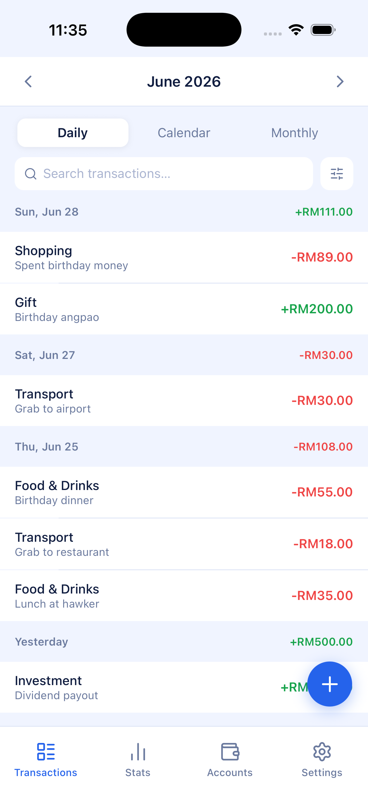<br/>
      <sub><b>Transactions - Daily</b></sub>
    </td>
    <td align="center" width="25%">
      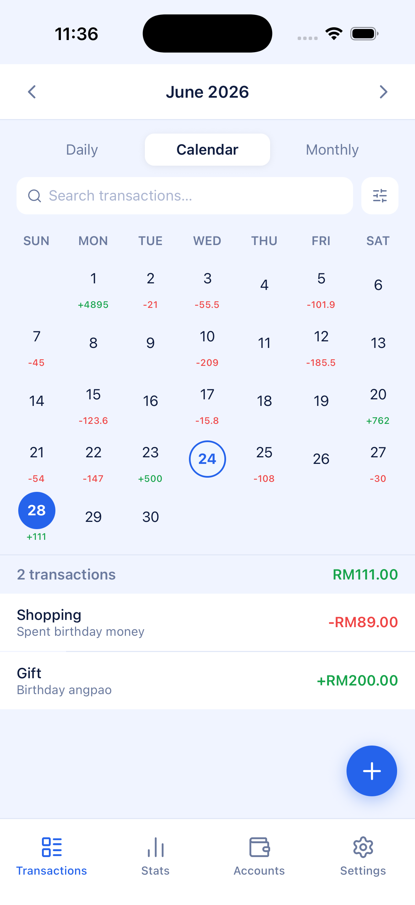<br/>
      <sub><b>Transactions - Calendar</b></sub>
    </td>
    <td align="center" width="25%">
      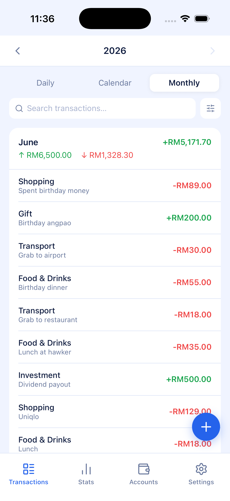<br/>
      <sub><b>Transactions - Monthly</b></sub>
    </td>
    <td align="center" width="25%">
      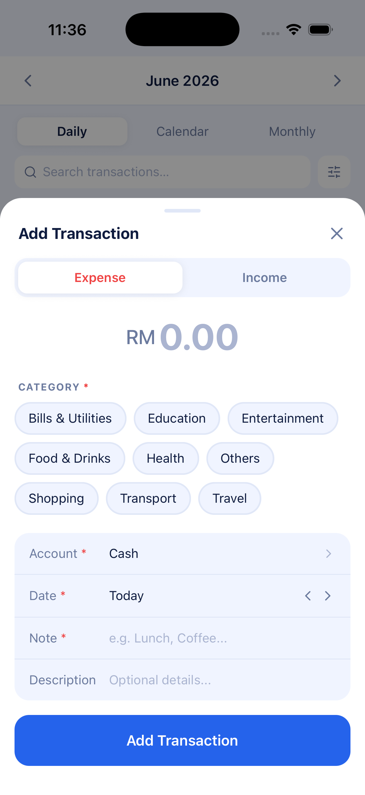<br/>
      <sub><b>Add Transaction</b></sub>
    </td>
  </tr>
  <tr>
    <td align="center" width="25%">
      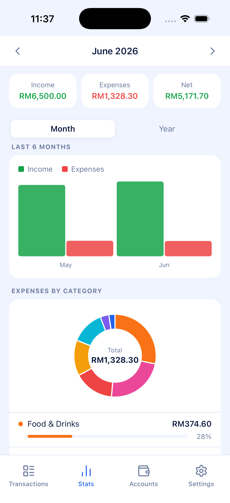<br/>
      <sub><b>Statistics — Monthly 1st section</b></sub>
    </td>
    <td align="center" width="25%">
      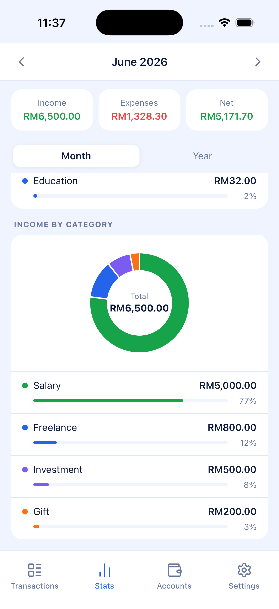<br/>
      <sub><b>Statistics — Monthly 2nd section</b></sub>
    </td>
    <td align="center" width="25%">
      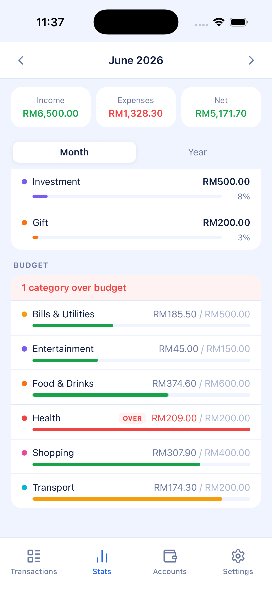<br/>
      <sub><b>Statistics — Monthly 3rd section</b></sub>
    </td>
    <td align="center" width="25%">
      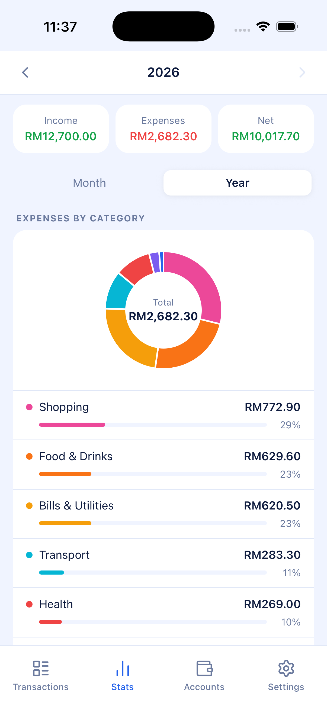<br/>
      <sub><b>Statistics — Annual</b></sub>
    </td>
  </tr>
  <tr>
    <td align="center" width="25%">
      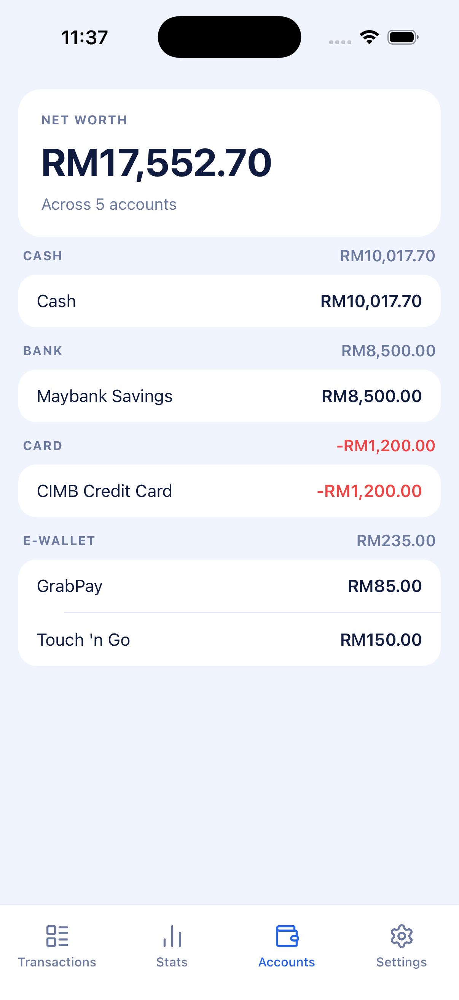<br/>
      <sub><b>Accounts</b></sub>
    </td>
    <td align="center" width="25%">
      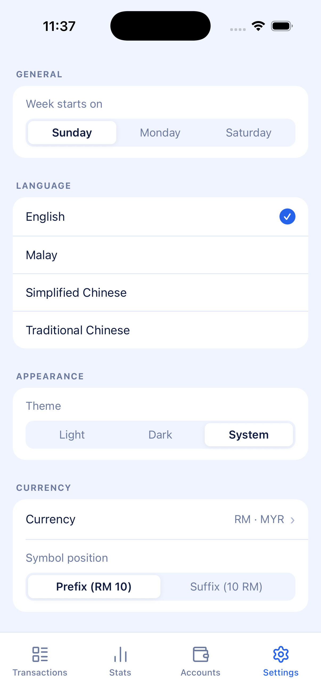<br/>
      <sub><b>Settings - General, Language, Appearance, Currency</b></sub>
    </td>
    <td align="center" width="25%">
      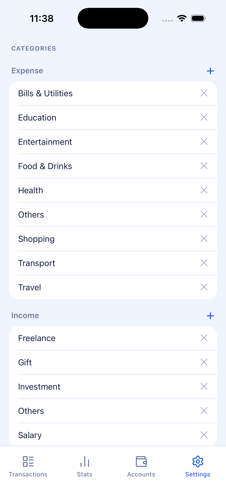<br/>
      <sub><b>Settings - Categories</b></sub>
    </td>
    <td align="center" width="25%">
      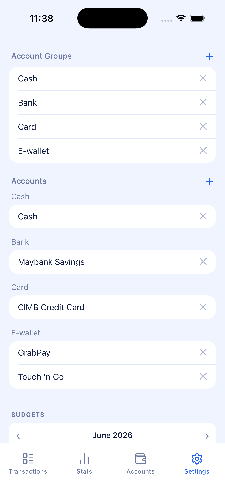<br/>
      <sub><b>Settings - Account Groups and Accounts</b></sub>
    </td>
  </tr>
  <tr>
    <td align="center" colspan="2" width="50%">
      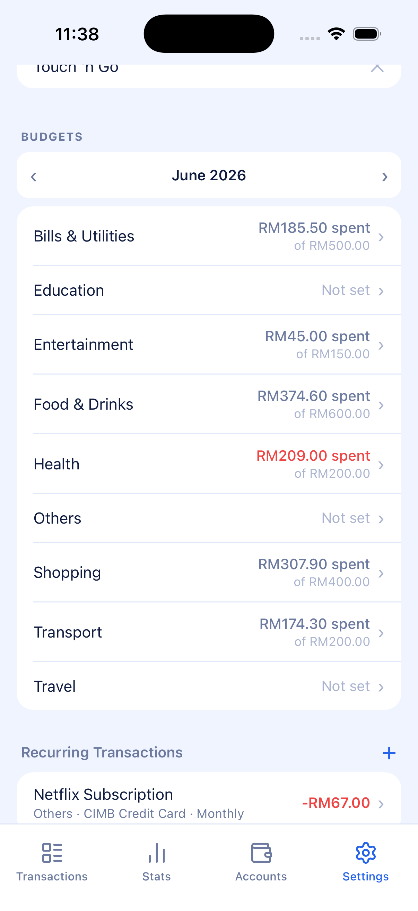<br/>
      <sub><b>Settings - Budgets</b></sub>
    </td>
    <td align="center" colspan="2" width="50%">
      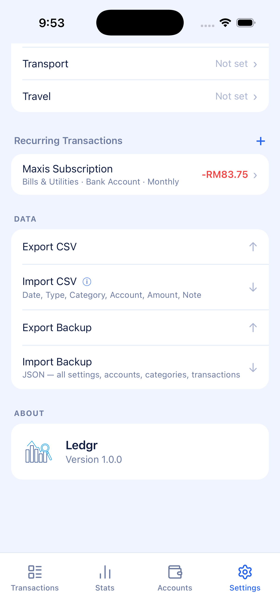<br/>
      <sub><b>Settings - Recurring Transactions, Data, About</b></sub>
    </td>
  </tr>
</table>

---

## Features

| Area                  | Details                                                                                                                                              |
| --------------------- | ---------------------------------------------------------------------------------------------------------------------------------------------------- |
| **Transactions**      | Add, edit, and delete income/expense entries with category, account, date, note, and optional description                                            |
| **Accounts**          | Multiple accounts with grouping, per-account balance tracking, and net worth summary                                                                 |
| **Budgets**           | Monthly category budgets with per-month overrides and over-budget alerts                                                                             |
| **Recurring Rules**   | Automated recurring transactions on daily, weekly, biweekly, monthly, end-of-month, bimonthly, and annual schedules                                  |
| **Statistics**        | Monthly and annual summaries, 6-month income/expense trend chart, and category breakdown donut charts                                                |
| **CSV Import/Export** | Export transactions as CSV; import from a compatible CSV file                                                                                        |
| **Backup & Restore**  | Export a full JSON backup (all settings, accounts, categories, transactions, budgets, recurring rules); import on a new device to restore everything |
| **Appearance**        | Light, dark, and system-adaptive themes                                                                                                              |
| **Localization**      | English, Bahasa Melayu, Simplified Chinese, Traditional Chinese                                                                                      |
| **Currency**          | Configurable currency symbol and position (prefix/suffix)                                                                                            |
| **Week Start**        | Configurable week start day (Sunday, Monday, Saturday)                                                                                               |

---

## Tech Stack

| Layer        | Technology                                                                          |
| ------------ | ----------------------------------------------------------------------------------- |
| Framework    | [Expo](https://expo.dev) SDK 58                                                     |
| Runtime      | React Native 0.88 (New Architecture, Hermes) with React 19.3                        |
| Navigation   | [Expo Router](https://docs.expo.dev/router/introduction/) (file-based)              |
| Database     | [expo-sqlite](https://docs.expo.dev/versions/latest/sdk/sqlite/) — on-device SQLite |
| Server state | [TanStack Query](https://tanstack.com/query/latest) v5                              |
| Styling      | [NativeWind](https://www.nativewind.dev) v4 (Tailwind CSS for React Native)         |
| Language     | TypeScript 6                                                                        |
| Icons        | [Lucide React Native](https://lucide.dev)                                           |

---

## Prerequisites

- **Node.js** 22.13+ or 24.3+ (required by Expo SDK 58; odd-numbered releases are not supported)
- **npm** 10 or later
- **Xcode** with an iOS Simulator (macOS only; currently built with Xcode 26.5)
- **CocoaPods** (iOS native dependencies)
- **Android Studio** (Android builds, optional)
- For a physical iPhone: a device running iOS 16.4 or later, with signing set up in Xcode

No global Expo CLI is needed. The project's local CLI runs through `npx expo`.

---

## Getting Started

### 1. Clone the repository

```bash
git clone https://github.com/yitmeng00/budget-tracker-mobile.git
cd budget-tracker-mobile
```

### 2. Install dependencies

```bash
npm install
```

### 3. Run on iOS Simulator

```bash
npm run ios
```

### 4. Run on Android Emulator

```bash
npm run android
```

`npm run ios` and `npm run android` generate the native `ios/` and `android/` folders (via Expo prebuild), compile a debug build, and start the Metro dev server.

### 5. Start the Metro dev server only

```bash
npm start
```

Use this to reconnect to a debug build that is already installed.

### 6. Install a release build on an iPhone

```bash
npx expo run:ios --configuration Release --device
```

This builds an optimised, standalone app that runs without Metro, and installs it on a connected iPhone.

> **Note:** The first launch initialises the SQLite database and seeds default settings, categories, account groups, and accounts. Subsequent launches load from the existing database without re-seeding.

### Native folders

`ios/` and `android/` are generated from `app.json` and are git-ignored, so don't edit them by hand. After upgrading Expo or changing native dependencies or config plugins, regenerate them:

```bash
npx expo prebuild --clean
```

If an iOS build fails with `node: No such file or directory`, `ios/.xcode.env.local` points to a Node version that is no longer installed. Running `npx expo prebuild --clean` regenerates it.

---

## Project Structure

```
.
├── app/                        # Expo Router screens
│   ├── _layout.tsx             # Root layout — providers, DB init, recurring processor
│   └── (tabs)/
│       ├── _layout.tsx         # Bottom tab bar
│       ├── index.tsx           # Transactions screen
│       ├── stats.tsx           # Statistics screen
│       ├── accounts.tsx        # Accounts screen
│       └── settings.tsx        # Settings screen
│
└── src/
    ├── components/             # UI components grouped by domain
    │   ├── transactions/       # AddTransactionSheet, FilterSheet, Daily/Calendar/MonthlyView, …
    │   ├── settings/           # ImportSheet, ExportSheet, RecurringRuleSheet
    │   ├── stats/              # TrendChart, DonutChart
    │   └── ui/                 # MonthHeader, ViewToggle
    │
    ├── context/
    │   ├── ThemeContext.tsx     # Theme provider and useColors hook
    │   └── LanguageContext.tsx # Language provider and useStrings hook
    │
    ├── db/
    │   ├── client.ts           # SQLite connection singleton
    │   ├── schema.ts           # CREATE TABLE statements and migrations
    │   └── seed.ts             # Default settings, categories, and accounts on first launch
    │
    ├── hooks/                  # TanStack Query hooks (one file per domain)
    ├── services/               # Raw SQLite query functions (no React)
    ├── lib/                    # Pure utilities: currency, date, i18n, constants
    └── types/                  # Shared TypeScript types and interfaces
```

---

## Architecture

### Data layer

All data is persisted in a single SQLite file managed by `expo-sqlite`. The database is opened once at app start (`src/db/client.ts`) and the schema is initialised synchronously (`src/db/schema.ts`). Query functions in `src/services/` are plain TypeScript with no framework dependency. React components access data exclusively through TanStack Query hooks in `src/hooks/`, which wrap the service functions and handle caching, background refetching, and optimistic updates.

### State management

There is no global client-side state store. All server state lives in the TanStack Query cache. Ephemeral UI state (sheet open/close, form fields) is local `useState` inside each component.

### Recurring transactions

On every app launch, `src/services/recurring.ts` checks all active recurring rules against today's date and creates any transactions that are due. It runs once, synchronously, in a `useEffect` in the root layout. If it creates any transactions, it invalidates the TanStack Query cache so every screen refetches and shows them.

### Navigation

File-based routing via Expo Router. The root layout is a stack, and the four screens live under `app/(tabs)/` in an Expo Router `Tabs` bottom tab bar, styled to match the app theme. Sheets (add transaction, filter, import/export, recurring rule editor, and the settings editors) are custom bottom sheets. They are built on the React Native `Animated` and `PanResponder` APIs through the shared `useBottomSheet` hook, which handles open/close animation and swipe-to-dismiss. Swipe actions on transaction rows use `react-native-gesture-handler`.

---

## Localization

Translations are defined in `src/lib/i18n.ts` as a `Strings` type with four translation objects: `en`, `ms`, `zhHans`, `zhHant`. The active language is read from the user's settings row in SQLite and applied via `LanguageContext`. All UI-visible strings are accessed through the `useStrings()` hook — no hardcoded English appears in component files.

To add a new language:

1. Add an entry to the `Language` union in `src/types/index.ts`.
2. Add a new translation object in `src/lib/i18n.ts` implementing the `Strings` type.
3. Register it in the `translations` map at the bottom of `i18n.ts`.
4. Add the language option to the language picker in `app/(tabs)/settings.tsx`.

---

## Data & Privacy

All user data is stored exclusively on-device in the local SQLite database. No data is transmitted to any server. CSV and JSON backup exports write a file to the app's local cache and open the native share sheet, so the file goes only where you choose to send or save it. The app does not upload data to any third-party service.

---

## License

Copyright © 2026 Wong Yit Meng. Released under the [MIT License](LICENSE).
